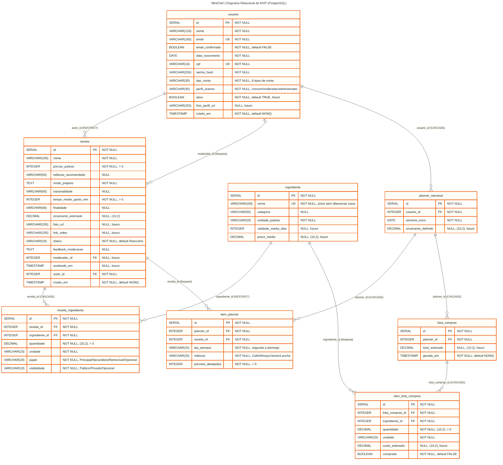

# MiniChef | Banco de Dados Relacional

Documentação do modelo relacional do MiniChef: escopo do MVP, visão completa do produto, dicionário de dados, regras de integridade, regras de negócio, consultas e plano de entrega.

**Disciplina:** Banco de Dados, FAESA, prof. Howard Roatti  
**Equipe:** Carlos Henrique Forechi Schmittel (escopo e modelagem), Cesar (back-end), Gabriel (front-end)  
**SGBD:** PostgreSQL | **Programa:** JavaScript (Node.js), driver `pg`, sem ORM

Versão visual deste documento: [MiniChef_Banco_de_Dados.pdf](MiniChef_Banco_de_Dados.pdf)

## Sumário

1. [O MiniChef](#1-o-minichef)
2. [Escopo](#2-escopo)
3. [Visão completa do banco](#3-visão-completa-do-banco)
4. [Projetado para crescer](#4-projetado-para-crescer)
5. [Diagrama relacional do MVP](#5-diagrama-relacional-do-mvp)
6. [Dicionário de dados](#6-dicionário-de-dados)
7. [Integridade](#7-integridade)
8. [Regras de negócio](#8-regras-de-negócio)
9. [Consultas e relatórios](#9-consultas-e-relatórios)
10. [Como criar o banco](#10-como-criar-o-banco)
11. [Checklist de entrega](#11-checklist-de-entrega)
12. [Critérios de avaliação](#12-critérios-de-avaliação)

## 1. O MiniChef

O MiniChef é um aplicativo de organização alimentar para quem cozinha, no dia a dia ou no trabalho. Ele reúne em um só lugar um banco de receitas estruturado, uma calculadora de porções, um planner semanal e uma lista de compras gerada a partir do planejamento.

| Problema | Como o banco responde |
|---|---|
| Receitas espalhadas, sem padrão de ingredientes e quantidades | Ingrediente como catálogo único (nome único); receitas apontam para ele com quantidade e unidade |
| Ajustar porções exige conta manual | A receita guarda a porção padrão; outras porções são calculadas na consulta, sem gravar valores derivados |
| Lista de compras montada de memória | A lista nasce do planner por uma consulta de agrupamento |
| Novas funcionalidades costumam exigir mudar o banco | Colunas futuras já reservadas e tabelas novas que só se ligam às existentes |

| 8 | 10 | 22 | 0 |
|---|---|---|---|
| tabelas no MVP | relacionamentos 1 para N | tabelas na visão completa | ALTER TABLE para crescer |

## 2. Escopo

| MVP do programa | Próximas fases (já modeladas) |
|---|---|
| **CRUD de receitas**, com ingredientes, papéis e moderação por status | Orçamento: preço médio, custo da lista e limite da semana |
| **Planner semanal**, por dia e refeição | Despensa com validade e pedido a mercado parceiro |
| **Calculadora inteligente de porções** | Informação nutricional, alergias e substituições |
| **Geração da lista de compras** a partir do planner | Pesquisa inteligente com histórico |
| Relatórios com agrupamento e junção | Rede social (Notícias), notificações, confirmação de e-mail, fotos e vídeos |

**Usuários do MVP:** usuário comum (cadastra receitas, monta o planner, gera a lista) e administrador (mantém o catálogo de ingredientes e analisa as receitas). Os demais tipos de conta já são aceitos por `usuario.tipo_conta`.

**Fluxo principal:** cadastrar ingredientes, cadastrar receitas com seus ingredientes, montar o planner com as porções desejadas, calcular as porções e gerar a lista de compras.

## 3. Visão completa do banco

22 tabelas em 6 módulos. Tabelas do MVP em **negrito** (script 01); as demais são das próximas fases (script 04).

| Módulo | Tabelas | Funcionalidades |
|---|---|---|
| Identidade | **usuario**, `codigo_confirmacao_email` | Cadastro, tipos de conta, confirmação de e-mail por código |
| Receitas | **ingrediente**, **receita**, **receita_ingrediente**, `informacao_nutricional`, `alergeno`, `receita_alergeno`, `substituicao` | CRUD com filtros, tabela nutricional, alertas de alergia, substituição de ingredientes |
| Planejamento | **planner_semanal**, **item_planner**, **lista_compras**, **item_lista_compras**, `item_despensa`, `pedido_mercado` | Planner, calculadora, lista de compras, despensa com validade, pedido a mercado |
| Pesquisa inteligente | `criterio_pesquisa` | Busca por ingrediente, porções, orçamento, tempo e refeição |
| Rede social (Notícias) | `postagem`, `postagem_midia`, `seguidor`, `curtida`, `comentario` | Feed, mídias, seguidores, curtidas e comentários com moderação |
| Notificações | `notificacao` | Avisos de análise de receita, interações e vencimento |

**Como as próximas fases se ligam ao MVP**

| Tabela futura | Módulo | Aponta para |
|---|---|---|
| `codigo_confirmacao_email` | Identidade | usuario |
| `informacao_nutricional` | Receitas | receita (1 para 1) |
| `alergeno` | Receitas | (catálogo) |
| `receita_alergeno` | Receitas | receita, alergeno |
| `substituicao` | Receitas | ingrediente (2 vezes) |
| `criterio_pesquisa` | Pesquisa | usuario |
| `item_despensa` | Planejamento | usuario, ingrediente |
| `pedido_mercado` | Planejamento | lista_compras, usuario (comprador e mercado) |
| `postagem` | Rede social | usuario |
| `postagem_midia` | Rede social | postagem |
| `seguidor` | Rede social | usuario (2 vezes) |
| `curtida` | Rede social | usuario, postagem ou receita |
| `comentario` | Rede social | usuario, postagem ou receita |
| `notificacao` | Notificações | usuario |

## 4. Projetado para crescer

Alterar a estrutura de um banco com dados reais é caro e arriscado. Por isso o modelo do MVP já nasce com tudo o que as próximas fases vão precisar nas tabelas existentes.

- **Colunas futuras já criadas e vazias.** Cada funcionalidade futura que precisa de um campo em uma tabela do MVP já tem a coluna, aceitando NULL. Exemplo: sem preços no MVP, `lista_compras.total_estimado` fica NULL até o orçamento entrar.
- **Tabelas novas só apontam para as antigas.** As 14 tabelas futuras dependem das tabelas do MVP por chave estrangeira, nunca o contrário. O script 04 foi executado sobre o banco do MVP e criou as 22 tabelas sem nenhum ALTER TABLE.

| Coluna reservada | Funcionalidade que vai preenchê-la | No MVP |
|---|---|---|
| `usuario.ativo` | Inativar conta que tem receitas, em vez de excluir | TRUE (padrão) |
| `usuario.foto_perfil_url` | Foto de perfil no feed de Notícias | NULL |
| `ingrediente.validade_media_dias` | Validade dos itens da despensa | NULL |
| `ingrediente.preco_medio` | Orçamento da lista de compras | NULL |
| `receita.foto_url` | Foto da receita | NULL |
| `receita.link_video` | Vídeo do YouTube ou Instagram | NULL |
| `receita.moderador_id e analisado_em` | Registro de quem aprovou ou recusou a receita | NULL |
| `planner_semanal.orcamento_definido` | Limite de gasto da semana | NULL |
| `lista_compras.total_estimado` | Total da lista comparado ao orçamento | NULL |
| `item_lista_compras.custo_estimado` | Custo de cada item | NULL |

Outras decisões que evitam retrabalho: tipos de conta e perfis já aceitam todos os valores do produto; domínios fixos com CHECK desde o primeiro registro; nome de ingrediente único sem diferenciar maiúsculas.

## 5. Diagrama relacional do MVP



Versões: [PDF](../diagrams/diagrama_relacional_minichef.pdf) | [fonte Mermaid](../diagrams/diagrama_relacional_minichef.mmd)

## 6. Dicionário de dados

Colunas marcadas com **FUTURO** são reservadas para as próximas fases e aceitam NULL.

### `usuario` (Identidade)

Pessoa cadastrada. Autor de receitas e dono de planners.

| Campo | Tipo | Chave | Nulo | Descrição |
|---|---|---|---|---|
| `id` | SERIAL | PK | Não | Identificador do usuário |
| `nome` | VARCHAR(120) |  | Não | Nome |
| `email` | VARCHAR(160) | UK | Não | Login, único |
| `email_confirmado` | BOOLEAN |  | Não | Validado por código (padrão FALSE) |
| `data_nascimento` | DATE |  | Não | Data de nascimento |
| `cpf` | VARCHAR(14) | UK | Não | CPF, único |
| `senha_hash` | VARCHAR(255) |  | Não | Senha gravada com hash |
| `tipo_conta` | VARCHAR(30) |  | Não | Usuário comum, Chef de cozinha, Hotel, Restaurante, Personal Trainer, Nutricionista, Administrador de eventos ou Mercado |
| `perfil_acesso` | VARCHAR(30) |  | Não | comum, moderador ou administrador |
| `ativo` | BOOLEAN |  | Não | **FUTURO.** Inativar a conta em vez de excluir (padrão TRUE) |
| `foto_perfil_url` | VARCHAR(255) |  | Sim | **FUTURO.** Foto de perfil no feed de Notícias |
| `criado_em` | TIMESTAMP |  | Não | Criação da conta |

### `ingrediente` (Receitas)

Catálogo mestre de ingredientes, mantido pelo administrador. Nome único.

| Campo | Tipo | Chave | Nulo | Descrição |
|---|---|---|---|---|
| `id` | SERIAL | PK | Não | Identificador |
| `nome` | VARCHAR(100) | UK | Não | Nome único, sem diferenciar maiúsculas de minúsculas |
| `categoria` | VARCHAR(50) |  | Sim | Proteína, vegetal, tempero... |
| `unidade_padrao` | VARCHAR(20) |  | Não | g, ml, unidade... |
| `validade_media_dias` | INTEGER |  | Sim | **FUTURO.** Conservação média, para a despensa |
| `preco_medio` | DECIMAL(10,2) |  | Sim | **FUTURO.** Preço por unidade padrão, para o orçamento da lista |

### `receita` (Receitas)

Receita cadastrada por um usuário, publicada após análise do administrador.

| Campo | Tipo | Chave | Nulo | Descrição |
|---|---|---|---|---|
| `id` | SERIAL | PK | Não | Identificador |
| `nome` | VARCHAR(150) |  | Não | Nome popular |
| `porcao_padrao` | INTEGER |  | Não | Porções da receita base (maior que 0) |
| `refeicao_recomendada` | VARCHAR(60) |  | Sim | Café da manhã, almoço... |
| `modo_preparo` | TEXT |  | Não | Passo a passo |
| `nacionalidade` | VARCHAR(60) |  | Sim | Origem do prato |
| `tempo_medio_gasto_min` | INTEGER |  | Não | Tempo total em minutos (maior que 0) |
| `finalidade` | VARCHAR(60) |  | Sim | Dia a dia, festa, nutrição |
| `orcamento_estimado` | DECIMAL(10,2) |  | Sim | Custo estimado nas porções padrão |
| `foto_url` | VARCHAR(255) |  | Sim | **FUTURO.** Foto da receita |
| `link_video` | VARCHAR(255) |  | Sim | **FUTURO.** Vídeo do YouTube ou Instagram |
| `status` | VARCHAR(20) |  | Não | Rascunho, Em Análise, Publicada, Recusada ou Arquivada |
| `feedback_moderacao` | TEXT |  | Sim | Justificativa do administrador |
| `moderador_id` | INTEGER | FK | Sim | **FUTURO.** Administrador que analisou (usuario) |
| `analisado_em` | TIMESTAMP |  | Sim | **FUTURO.** Data da análise |
| `autor_id` | INTEGER | FK | Não | Quem cadastrou (usuario) |
| `criado_em` | TIMESTAMP |  | Não | Cadastro |

### `receita_ingrediente` (Receitas)

Liga receita e ingrediente (N para N), com quantidade, unidade e papel.

| Campo | Tipo | Chave | Nulo | Descrição |
|---|---|---|---|---|
| `id` | SERIAL | PK | Não | Identificador do vínculo |
| `receita_id` | INTEGER | FK | Não | Receita |
| `ingrediente_id` | INTEGER | FK | Não | Ingrediente |
| `quantidade` | DECIMAL(10,2) |  | Não | Quantidade para a porção padrão (maior que 0) |
| `unidade` | VARCHAR(20) |  | Não | Unidade usada na receita |
| `papel` | VARCHAR(20) |  | Não | Principal, Secundário, Removível ou Opcional |
| `visibilidade` | VARCHAR(10) |  | Não | Público, Privado ou Opcional |

### `planner_semanal` (Planejamento)

Planejamento de uma semana de um usuário.

| Campo | Tipo | Chave | Nulo | Descrição |
|---|---|---|---|---|
| `id` | SERIAL | PK | Não | Identificador |
| `usuario_id` | INTEGER | FK | Não | Dono do planner |
| `semana_inicio` | DATE |  | Não | Primeiro dia da semana |
| `orcamento_definido` | DECIMAL(10,2) |  | Sim | **FUTURO.** Limite de gasto da semana |

### `item_planner` (Planejamento)

Receita escolhida para um dia e uma refeição, com o número de porções desejado.

| Campo | Tipo | Chave | Nulo | Descrição |
|---|---|---|---|---|
| `id` | SERIAL | PK | Não | Identificador |
| `planner_id` | INTEGER | FK | Não | Planner |
| `receita_id` | INTEGER | FK | Não | Receita planejada |
| `dia_semana` | VARCHAR(15) |  | Não | segunda a domingo |
| `refeicao` | VARCHAR(20) |  | Não | Café da manhã, Almoço, Jantar ou Lanche |
| `porcoes_desejadas` | INTEGER |  | Não | Entrada da calculadora (maior que 0) |

### `lista_compras` (Planejamento)

Lista gerada a partir de um planner.

| Campo | Tipo | Chave | Nulo | Descrição |
|---|---|---|---|---|
| `id` | SERIAL | PK | Não | Identificador |
| `planner_id` | INTEGER | FK | Não | Planner de origem |
| `total_estimado` | DECIMAL(10,2) |  | Sim | **FUTURO.** Soma dos custos dos itens |
| `gerada_em` | TIMESTAMP |  | Não | Data e hora da geração |

### `item_lista_compras` (Planejamento)

Ingrediente agregado a comprar.

| Campo | Tipo | Chave | Nulo | Descrição |
|---|---|---|---|---|
| `id` | SERIAL | PK | Não | Identificador |
| `lista_compras_id` | INTEGER | FK | Não | Lista |
| `ingrediente_id` | INTEGER | FK | Não | Ingrediente |
| `quantidade` | DECIMAL(10,2) |  | Não | Quantidade total (maior que 0) |
| `unidade` | VARCHAR(20) |  | Não | Unidade |
| `custo_estimado` | DECIMAL(10,2) |  | Sim | **FUTURO.** Quantidade x preço médio |
| `comprado` | BOOLEAN |  | Não | Marcado como comprado (padrão FALSE) |

## 7. Integridade

| Pai | Filho | Regra no banco | O que o programa faz ao remover o pai |
|---|---|---|---|
| `usuario` | receita (autor) | RESTRICT | Avisa que o registro está em uso e não exclui |
| `usuario` | receita (moderador) | BLOQUEIA | Avisa e pergunta se remove os filhos antes; se não, cancela |
| `usuario` | planner_semanal | CASCADE | Mostra quantos filhos existem e pergunta se remove junto |
| `ingrediente` | receita_ingrediente | RESTRICT | Avisa que o registro está em uso e não exclui |
| `ingrediente` | item_lista_compras | BLOQUEIA | Avisa e pergunta se remove os filhos antes; se não, cancela |
| `receita` | receita_ingrediente | CASCADE | Mostra quantos filhos existem e pergunta se remove junto |
| `receita` | item_planner | BLOQUEIA | Avisa e pergunta se remove os filhos antes; se não, cancela |
| `planner_semanal` | item_planner | CASCADE | Mostra quantos filhos existem e pergunta se remove junto |
| `planner_semanal` | lista_compras | CASCADE | Mostra quantos filhos existem e pergunta se remove junto |
| `lista_compras` | item_lista_compras | CASCADE | Mostra quantos filhos existem e pergunta se remove junto |

**Regra do programa:** antes de qualquer remoção, contar os filhos com `SELECT COUNT(1) ... WHERE chave_estrangeira = id` (script 03) e decidir pela tabela acima.

| Tipo | Tabela | Regra |
|---|---|---|
| UNIQUE | usuario | email e cpf |
| UNIQUE | ingrediente | nome, sem diferenciar maiúsculas (índice em `LOWER(nome)`) |
| CHECK | usuario | tipo_conta (8 tipos) e perfil_acesso |
| CHECK | receita | porcao_padrao e tempo_medio_gasto_min maiores que 0; status em 5 valores |
| CHECK | receita_ingrediente | quantidade maior que 0; papel e visibilidade |
| CHECK | item_planner | porcoes_desejadas maior que 0; dia_semana e refeicao |
| CHECK | item_lista_compras | quantidade maior que 0 |

## 8. Regras de negócio

### Calculadora de porções

`quantidade ajustada = quantidade base x porções desejadas / porção padrão`

Exemplo com dados fictícios, "Arroz soltinho" de 4 para 8 porções:

| Ingrediente | Base (4 porções) | Cálculo | Ajustado (8 porções) |
|---|---|---|---|
| Arroz branco | 400 g | 400 x 8 / 4 | **800 g** |
| Cebola | 1 unidade | 1 x 8 / 4 | **2 unidade** |
| Alho | 2 dente | 2 x 8 / 4 | **4 dente** |
| Azeite | 15 ml | 15 x 8 / 4 | **30 ml** |

Escala linear, 2 casas decimais, calculada na consulta e não gravada. O tempo de preparo não é recalculado no MVP.

### Lista de compras

Soma, por ingrediente e unidade, as quantidades ajustadas de todos os itens do planner e grava `lista_compras` e `item_lista_compras` em uma transação.

- Papel **Opcional** não entra; Principal, Secundário e Removível entram.
- Unidades contáveis (unidade, dente) arredondam para cima; as demais ficam com 2 casas.
- Mesmo ingrediente em unidades diferentes vira linhas separadas.
- Sem preço no MVP: `custo_estimado` e `total_estimado` ficam NULL.

Resultado com os dados fictícios do planner 1:

| Ingrediente | Quantidade | Unidade |
|---|---|---|
| Alho | 13 | dente |
| Arroz branco | 1200 | g |
| Azeite | 65 | ml |
| Cebola | 4 | unidade |
| Feijão carioca | 500 | g |
| Ovo | 4 | unidade |
| Peito de frango | 800 | g |

## 9. Consultas e relatórios

Todas as consultas estão em [`sql/03_consultas.sql`](../sql/03_consultas.sql). Resultados com os dados fictícios do script 02:

**R1 | Agrupamento: receitas por refeição**

| Refeição | Receitas | Tempo médio | Orçamento médio |
|---|---|---|---|
| Almoço | 3 | 40 min | R$ 7,83 |
| Café da manhã | 1 | 10 min | R$ 4 |
| Jantar | 1 | 30 min | R$ 14 |
| Lanche | 1 | 15 min | R$ 3,5 |

**R2 | Junção: ficha de ingredientes por receita (amostra)**

| Receita | Autor | Ingrediente | Qtd | Un. | Papel |
|---|---|---|---|---|---|
| Arroz soltinho | Ana Exemplo | Arroz branco | 400 | g | Principal |
| Arroz soltinho | Ana Exemplo | Cebola | 1 | unidade | Secundário |
| Arroz soltinho | Ana Exemplo | Alho | 2 | dente | Secundário |
| Arroz soltinho | Ana Exemplo | Azeite | 15 | ml | Removível |
| Omelete simples | Bruno Exemplo | Ovo | 2 | unidade | Principal |
| Omelete simples | Bruno Exemplo | Tomate | 1 | unidade | Opcional |
| Omelete simples | Bruno Exemplo | Cebola | 0,5 | unidade | Opcional |
| Omelete simples | Bruno Exemplo | Queijo muçarela | 30 | g | Opcional |

**R3 | Ingredientes mais usados**

| Ingrediente | Receitas |
|---|---|
| Alho | 4 |
| Cebola | 4 |
| Azeite | 3 |
| Ovo | 2 |
| Tomate | 2 |
| Arroz branco | 1 |

**R4 | Junção: planner semanal**

| Dia | Refeição | Receita | Porção padrão | Porções desejadas |
|---|---|---|---|---|
| segunda | Almoço | Arroz soltinho | 4 | 8 |
| segunda | Almoço | Feijão caseiro | 6 | 6 |
| terça | Jantar | Frango grelhado | 2 | 4 |
| quarta | Café da manhã | Omelete simples | 1 | 2 |
| quinta | Almoço | Arroz soltinho | 4 | 4 |

**Tela inicial: registros por tabela**

| Tabela | Total |
|---|---|
| `usuario` | 4 |
| `ingrediente` | 12 |
| `receita` | 6 |
| `receita_ingrediente` | 21 |
| `planner_semanal` | 2 |
| `item_planner` | 6 |
| `lista_compras` | 1 |
| `item_lista_compras` | 7 |

## 10. Como criar o banco

| Script | O que faz | Quando executar |
|---|---|---|
| [`01_create_tables.sql`](../sql/01_create_tables.sql) | Cria as 8 tabelas do MVP, chaves, restrições e índices | Sempre, primeiro |
| [`02_insert_samples.sql`](../sql/02_insert_samples.sql) | Insere dados fictícios de demonstração | Para demonstração |
| [`03_consultas.sql`](../sql/03_consultas.sql) | Relatórios, calculadora, lista de compras, contagens | Referência para o programa |
| [`04_expansao_futura.sql`](../sql/04_expansao_futura.sql) | Cria as 14 tabelas das próximas fases sem alterar as do MVP | Fora do MVP, opcional |

```bash
sudo -u postgres psql -c "CREATE DATABASE minichef;"
sudo -u postgres psql -d minichef -f sql/01_create_tables.sql
sudo -u postgres psql -d minichef -f sql/02_insert_samples.sql
```

```
minichef-banco-de-dados/
├── README.MD          como executar no Linux              Cesar
├── docs/              este documento (PDF e Markdown)     Carlos
├── diagrams/          diagrama relacional                 Carlos
├── sql/               scripts 01 a 04                     Carlos
└── src/
    ├── package.json   dependência única: pg               Cesar
    ├── principal.js   menu principal                      Gabriel
    ├── conexion/      conexão com o PostgreSQL            Cesar
    ├── model/         uma classe por tabela               Cesar
    ├── controller/    CRUD de cada tabela                 Cesar
    ├── reports/       relatórios                          Gabriel
    ├── sql/           um .sql por relatório               Gabriel
    └── utils/         config.js (Cesar), splash_screen.js (Gabriel)
```

## 11. Checklist de entrega

O que cada integrante realiza e sobe no GitHub para concluir 100% do trabalho.

### Cesar | Back-end: tudo que conversa com o banco

- [ ] **Repositório.** Criar o repositório no GitHub e adicionar Carlos, Gabriel e o professor (usuário howardroatti) como colaboradores
- [ ] **Ambiente.** Instalar e testar PostgreSQL e Node.js na VM da disciplina; anotar as versões para o README
- [ ] **Projeto.** src/package.json com a única dependência pg; .gitignore com node_modules
- [ ] **Conexão.** src/conexion/ com a conexão ao PostgreSQL e src/utils/config.js com os dados de acesso
- [ ] **Models.** src/model/: uma classe por tabela (8), com getters, setters e toString; a classe guarda o objeto relacionado (ex.: Receita guarda o Usuario autor), não só o id
- [ ] **Controllers.** src/controller/: inserir, listar, atualizar e remover para cada tabela, verificando se o registro existe antes de atualizar ou remover
- [ ] **SQL sem ORM.** Montar o SQL como texto concatenado, com uma função única que trata aspas simples
- [ ] **Remoção com FK.** Antes de excluir, contar os filhos (consultas do script 03) e informar a tela se pode excluir, se precisa remover os filhos ou se está bloqueado
- [ ] **Erros do banco.** Tratar ingrediente repetido, CPF ou e-mail repetido e valores fora do domínio com mensagem clara, sem derrubar o programa
- [ ] **Regras de negócio.** Calculadora de porções e geração da lista de compras com as consultas do script 03, em transação (BEGIN e COMMIT)
- [ ] **README.MD.** Na raiz: objetivo, requisitos, criação do banco, instalação e execução no Linux passo a passo, link do vídeo e link para docs/

### Gabriel | Front-end: tudo que o usuário vê

- [ ] **Tela inicial.** src/utils/splash_screen.js: nome do sistema, integrantes e total de registros de cada uma das 8 tabelas
- [ ] **Menu principal.** src/principal.js: menu sempre visível com 1 Relatórios, 2 Inserir, 3 Remover, 4 Atualizar, 5 Gerar lista de compras, 0 Sair
- [ ] **Submenu de tabelas.** Escolha da tabela (8 opções) para inserir, remover e atualizar, exibido de novo a cada ação
- [ ] **Inserir.** Pedir cada campo da tabela; campos de valores fixos (tipo de conta, papel, dia, refeição, status) como opções numeradas; perguntar se deseja inserir mais
- [ ] **Remover.** Listar registros (id e nome), escolher, confirmar, exibir o aviso de FK ou a pergunta sobre os filhos; perguntar se deseja remover mais
- [ ] **Atualizar.** Listar, escolher o registro e o campo a alterar (nunca o id), exibir o registro atualizado; perguntar se deseja atualizar mais
- [ ] **Relatórios.** src/reports/ e src/sql/: R1 (agrupamento), R2 (junção), R3, R4 e calculadora, um arquivo .sql por relatório, exibidos em tabela alinhada
- [ ] **Interface.** Limpar a tela, títulos claros, validação de números e datas, mensagens de erro que dizem o que fazer
- [ ] **Vídeo.** Gravar e publicar no YouTube o objetivo do trabalho e todos os menus funcionando (sem explicar código); link no README

### Carlos | Escopo e modelagem (concluído)

- [x] docs/: este documento em PDF e em Markdown
- [x] sql/: scripts 01 a 04 (criação, exemplos, consultas, expansão futura)
- [x] diagrams/: diagrama relacional em PDF, PNG e fonte Mermaid

### Todos | Antes de entregar

- [ ] Cada integrante com commits próprios no repositório
- [ ] Rodar o fluxo completo na VM da disciplina, do script 01 ao menu Sair
- [ ] Cada um saber explicar o código que subiu
- [ ] Postar no AVA apenas o link do repositório até 30/10/2026

## 12. Critérios de avaliação

| Critério | Nota | Responsável | Itens do checklist |
|---|---|---|---|
| Relatórios: agrupamento | 1,0 | Gabriel | R1 |
| Relatórios: junção | 0,5 | Gabriel | R2 |
| Inserir: fluxo completo | 1,0 | Gabriel e Cesar | Inserir, Controllers |
| Inserir: perguntar se continua | 0,5 | Gabriel | Inserir |
| Remover: fluxo completo | 1,0 | Gabriel e Cesar | Remover, Controllers |
| Remover: tratamento de FK | 0,5 | Cesar e Gabriel | Remoção com FK, Remover |
| Atualizar: fluxo completo | 1,0 | Gabriel e Cesar | Atualizar, Controllers |
| Atualizar: exibir registro e continuar | 0,5 | Gabriel | Atualizar |
| Diagrama relacional | 0,5 | Carlos | diagrams/ |
| Interface amigável | 0,5 | Gabriel | Interface |
| Vídeo no YouTube | 0,5 | Gabriel | Vídeo |
| README.MD para Linux | 0,5 | Cesar | README.MD |
| **Total** | **8,0** |  |  |

**Condições que zeram ou reduzem a nota:** integrante sem commits tem a nota individual zerada; atraso custa 0,5 ponto por dia, sem substitutiva; entrega fora das orientações do professor é desconsiderada; código que o grupo não sabe explicar perde pontos; o trabalho precisa rodar na VM da disciplina.
